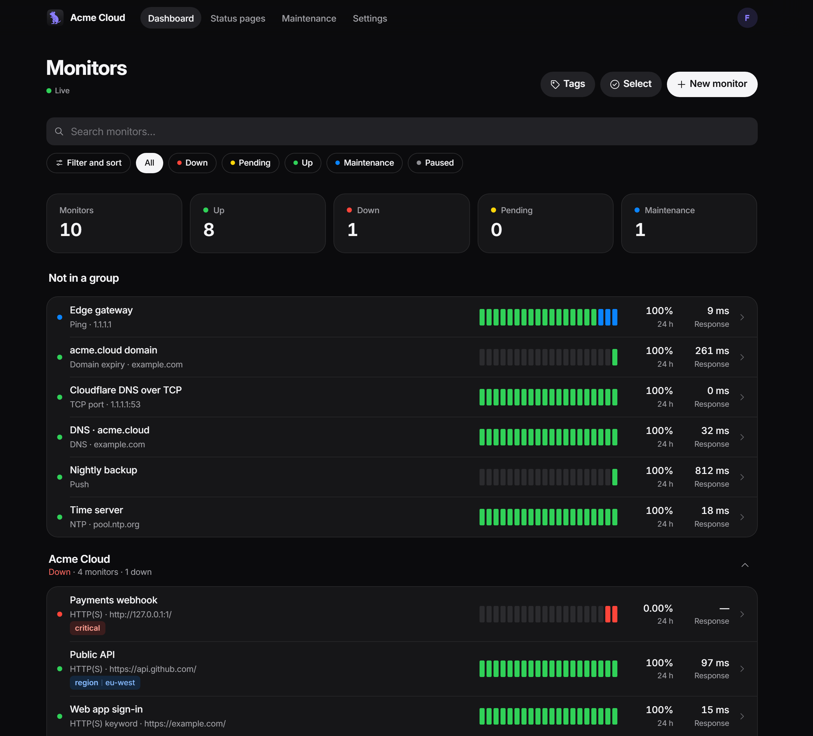
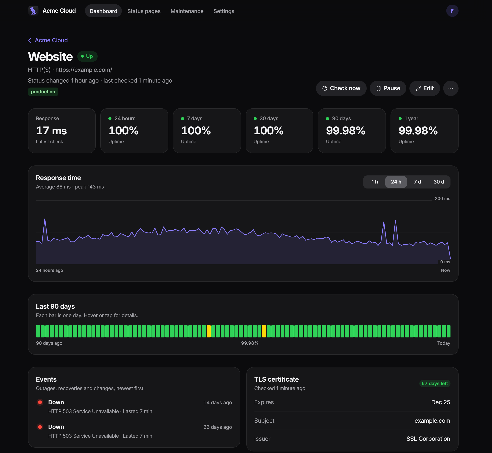
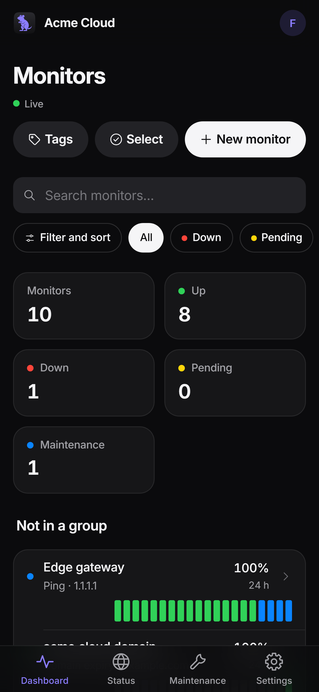
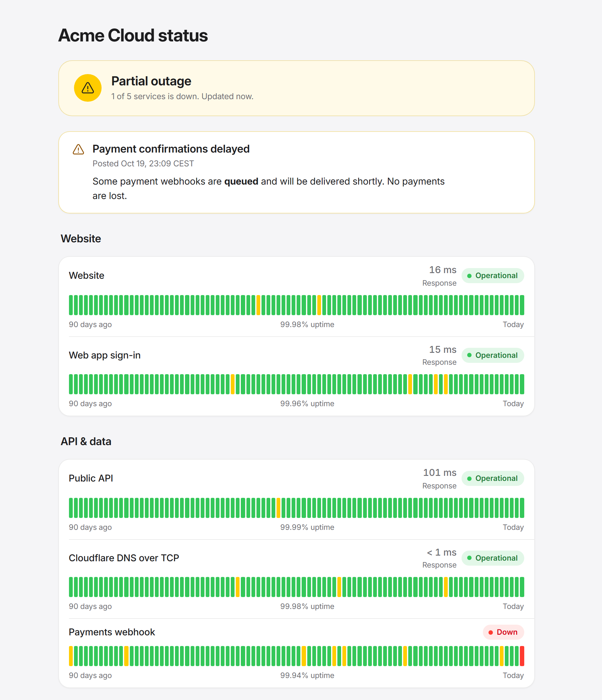

<div align="center">

<picture>
  <source media="(prefers-color-scheme: dark)" srcset="assets/brand/vole-logo-dark.svg">
  
</picture>

**A lightweight, self-hosted uptime monitor built in Rust.**
Single binary. Single Docker container. One volume. Inspired by [Uptime Kuma](https://github.com/louislam/uptime-kuma), built for a smaller footprint — and a few things Kuma doesn't do.

[](LICENSE)
[](https://www.rust-lang.org/)
[](#-quick-start)
[](#-unraid)
[](https://hedgerow.tools/Vigilant-Vole/)

<picture>
  <source media="(prefers-color-scheme: dark)" srcset="assets/screenshots/dashboard-dark.png">
  <source media="(prefers-color-scheme: light)" srcset="assets/screenshots/dashboard-light.png">
  
</picture>

</div>

## Contents

- [Features](#-features)
- [Screenshots](#-screenshots)
- [Vigilant Vole vs Uptime Kuma](#-vigilant-vole-vs-uptime-kuma)
- [Quick start](#-quick-start)
- [Unraid](#-unraid)
- [Linux (systemd)](#-linux-systemd)
- [Proxmox VE (LXC)](#-proxmox-ve-lxc)
- [Configuration](#-configuration)
- [Monitor types](#-monitor-types)
- [Notifications](#-notifications)
- [Status pages and badges](#-status-pages-and-badges)
- [Remote agents](#-remote-agents)
- [Docker label discovery](#-docker-label-discovery)
- [REST API](#-rest-api)
- [Config as code](#-config-as-code)
- [Translations](#-translations)
- [Migrating from Uptime Kuma](#-migrating-from-uptime-kuma)
- [Prometheus and Grafana](#-prometheus-and-grafana)
- [Backup and restore](#-backup-and-restore) · [Upgrading](docs/upgrading.md)
- [Security](#-security)
- [Building from source](#-building-from-source)
- [Architecture](#-architecture)
- [Roadmap](#-roadmap)
- [License](#-license)

## ✨ Features

**Monitoring**
- **30 monitor types** — HTTP(S), HTTP keyword, HTTP JSON query (JSONPath), TCP port, ICMP ping, Tailscale ping, DNS (9 record types, custom resolver), push/heartbeat, Docker container, WebSocket, domain expiry (RDAP), NTP, Steam game server, game server (Minecraft Java and Bedrock, Satisfactory, FiveM/RedM, Mumble), **TLS handshake, SMTP, Redis, PostgreSQL, MySQL/MariaDB, MQTT, Kafka, RabbitMQ, gRPC health, gRPC keyword, RADIUS, SNMP (v1/v2c/v3), SQL Server, MongoDB, real browser**, and groups
- **Real-browser checks** — load a page in a headless Chromium (browserless, chromedp/headless-shell) over the DevTools protocol: status, text or CSS selector, JavaScript errors, desktop or mobile viewport, and a screenshot of the last failure. The browser runs as its own container, so this image stays small — see [docs/real-browser.md](docs/real-browser.md)
- **TLS certificate and domain expiry** warnings, configurable per monitor
- **Groups and tags** — nest monitors under group monitors (status = worst child), colour-coded tags with values, search and filters, clone, and bulk actions: select monitors (or every one matching a filter) to pause, resume, delete or **edit them together** — remote agents, check interval and timing, notification channels and tags — also via `POST /api/v1/monitors/bulk`
- **Maintenance windows** — manual, one-off, daily, weekly, every N days, days of the month (including “last day”) or a **cron expression** (any time zone, across midnight and DST changes); monitors record *maintenance* and stay quiet

**AI assistants**
- **MCP server** — connect your own Claude Code, Claude Desktop or any MCP client (`POST /mcp`, Streamable HTTP, or the `vigilant-vole mcp` stdio bridge) with an API token: a read token to ask what's down and why, a write token to pause monitors, post incident updates or start maintenance. Vigilant Vole never calls an AI itself; secrets are masked and nothing can delete data — see [docs/mcp.md](docs/mcp.md)

**Alerting**
- **40 notification providers**, plus **Apprise** for 90+ more services — see [Notifications](#-notifications)
- **Smart alerting** — retries with a separate retry interval, upside-down mode, reminders every N down checks, **escalation** channels after N minutes down, **flap detection**, and recovery messages that say **how long it was down**
- **Multi-location remote agents** — run checks from other networks and **only alert when agents confirm the outage**

**Sharing**
- **Status pages** — Apple-style public pages with sections, 90-day uptime bars, incidents (Markdown, pinned) with a status timeline of updates (investigating → identified → monitoring → resolved) and an **Atom feed** per page, scheduled maintenance, light/dark/auto theme, custom CSS, **custom domains**, logo and icon, password protection, built-in cookie-free analytics, embeddable JSON
- **SVG badges** — status, uptime, response time and certificate expiry

**Operating it**
- **REST API** with an in-app reference and **OpenAPI 3.1** document
- **Config as code** — the whole setup as one YAML/JSON file: export, dry-run, merge or replace, GitOps on start
- **Docker label auto-discovery** — label a container, get a monitor
- **Uptime Kuma importer** — reads `kuma.db` (1.23 and 2.x) or Kuma's JSON backup
- **Prometheus `/metrics`** with Kuma-compatible metric names, so existing Grafana dashboards work
- **Backup and restore** — consistent database snapshot download, restore on next start
- **Multi-user with roles** (admin, editor, viewer), **TOTP 2FA** with recovery codes, **passkeys**, **API tokens** (read/write, expiring)
- **Data retention** with daily rollups — long-range uptime survives deleting old heartbeats
- **26 interface languages**, chosen per user: English, Norwegian (bokmål), Arabic, Chinese (Simplified and Traditional), Czech, Danish, Dutch, Finnish, French, German, Hebrew, Hungarian, Italian, Japanese, Korean, Persian, Polish, Portuguese (Brazil and Portugal), Romanian, Russian, Spanish, Swedish, Turkish and Ukrainian. All but English and Norwegian are marked beta; [help improve a translation](docs/translating.md). Plural rules (including few/many and Arabic's six forms), number, digit and date formats follow each language, and Arabic, Hebrew and Persian run right-to-left
- **Live dashboard** over Server-Sent Events, Apple-style UI in light and dark, works on a phone, installable as a PWA
- **Tiny** — one ~38 MB static binary, ~20 MB compressed image, a few MB of RAM idle

## 📸 Screenshots

<table>
  <tr>
    <td width="66%"></td>
    <td width="34%"></td>
  </tr>
  <tr>
    <td colspan="2" align="center"></td>
  </tr>
</table>

## 🆚 Vigilant Vole vs Uptime Kuma

Uptime Kuma is an excellent, mature project with a big community — Vigilant Vole borrows a lot of its ideas. Here's an honest comparison against Kuma 1.23 / 2.0:

| | Vigilant Vole | Uptime Kuma |
|---|---|---|
| **Runtime** | One static Rust binary, server-rendered HTML ([Askama](https://askama.readthedocs.io/) + [htmx](https://htmx.org/)) | Node.js + Vue SPA |
| **Docker image** | ~20 MB compressed (~70 MB on disk) | Hundreds of MB |
| **Idle memory** | A few MB | Typically 100 MB+ |
| **Database** | SQLite (bundled) | SQLite, or MariaDB/MySQL in 2.0 ✅ |
| HTTP(S), keyword, JSON query, TCP, ping, DNS, push, Docker, Steam, groups, WebSocket | ✅ | ✅ |
| Domain expiry (RDAP), NTP monitors | ✅ | NTP ❌ · domain expiry varies by version |
| Database monitors: PostgreSQL, MySQL/MariaDB, Redis | ✅ | ✅ |
| Database monitors: SQL Server, MongoDB | ✅ | ✅ |
| MQTT, Kafka, RabbitMQ, gRPC health checks, RADIUS, SNMP v1/v2c, SMTP, TLS handshake | ✅ | ✅ (no TLS-handshake type) |
| gRPC keyword calls (any unary method, JSON request, text in the JSON answer) | ✅ `.proto` or server reflection; metadata is sent | ✅ pasted `.proto` only |
| SNMPv3 | ✅ every security level: MD5, SHA-1, SHA-2 authentication; DES, AES-128/192/256 privacy | ✅ noAuthNoPriv only |
| Tailscale ping | ✅ through the host's mounted `tailscaled` socket | ✅ via the `tailscale` CLI (not in the Docker image) |
| Game servers | ✅ a curated set: Valve/Source games (A2S, Steam type), Minecraft Java and Bedrock, Satisfactory, FiveM/RedM, Mumble | ✅ ~360 games via GameDig |
| Real-browser (headless Chrome) monitor | ✅ via a remote browser (CDP) | ✅ (built-in Chromium or a remote browser) |
| HTTP auth | Basic, OAuth2 client credentials, mTLS ✅ | Basic, NTLM, mTLS, OAuth2 client credentials ✅ |
| Notification providers | 40 native + Apprise (90+ services) | **90+ native** ✅ |
| Reminders (resend while down) | ✅ | ✅ |
| Escalation channels after N minutes | ✅ | ❌ |
| Flap detection | ✅ | ❌ |
| Multi-location checks / outage confirmation | ✅ remote agents | ❌ |
| Status pages, custom domains, badges | ✅ | ✅ |
| Status page logo upload, analytics, password protection | ✅ incl. built-in, cookie-free analytics | Logo and analytics ✅ · password protection ❌ |
| Incidents | Multiple per page, pinned, history, update timeline, Atom feed | One active incident per page |
| Status page subscribers | ✅ email (double opt-in) and webhook | ❌ |
| Maintenance windows | ✅ manual, once, daily, weekly, every N days, days of the month, cron | ✅ the same |
| Multiple users with roles | ✅ admin / editor / viewer | ❌ single user |
| 2FA (TOTP) | ✅ + recovery codes | ✅ |
| REST API | ✅ full CRUD + OpenAPI | ❌ (socket.io; API keys for metrics only) |
| Config as code / GitOps | ✅ YAML/JSON, dry-run, merge/replace | ❌ |
| Docker label auto-discovery | ✅ built in | ❌ (third-party AutoKuma) |
| Prometheus metrics | ✅ (Kuma-compatible names + more) | ✅ |
| Long-range uptime after retention | ✅ daily rollups | ✅ aggregate tables in 2.0 |
| Import from the other one | ✅ reads `kuma.db` | – |
| MCP server for AI assistants (read/write tokens) | ✅ | ❌ |
| Interface languages | 26 (English, Norwegian, and 24 beta languages incl. ar, he, fa, ja, ko, zh, ru, uk) | **~50 languages** ✅ |
| Built-in Cloudflare Tunnel | ❌ | ✅ |

If you need a language outside the 26 above, or real-browser checks without running a separate browser container, Kuma is the better fit today.

## 🚀 Quick start

Requires Docker. Clone the repo, then:

```bash
git clone https://github.com/Ferdinand99/Vigilant-Vole.git
cd Vigilant-Vole
docker compose up -d
```

Open **http://localhost:3001** — you'll land on a one-time setup wizard to create the admin account, then the dashboard. On a fresh instance the wizard asks for a setup token: the app logs it at start (`docker logs vigilant-vole`, a line with `/setup?token=…`), or set `VV_SETUP_TOKEN` yourself.

`docker-compose.yml` (abridged — the file in the repo has commented extras: Docker socket, config file, a remote agent):

```yaml
services:
  vigilant-vole:
    build: .
    image: vigilant-vole:latest
    container_name: vigilant-vole
    restart: unless-stopped
    ports:
      - "3001:3001"
    volumes:
      - ./data:/data
    environment:
      - DATA_DIR=/data
      # - VV_TRUST_PROXY=1   # behind a reverse proxy
    cap_add:
      - NET_RAW # raw ICMP fallback for ping monitors
```

Everything persistent — the SQLite database, the session key and automatic pre-migration backups — lives under `./data`. Deleting that folder resets the app to a blank slate.

> **The app runs as the unprivileged user `vole`** — uid/gid 1000 by default, or whatever you set with `PUID`/`PGID` (Unraid: `99`/`100`). On start, the container hands `/data` to that user, picks up the group of a mounted Docker socket, and then drops root, so new folders and data from older root-run images just work. Setting `user:` / `--user` instead skips all of that: the folder must then already be writable, and socket access needs `group_add`.

Ping monitors work without root: the binary uses unprivileged ICMP sockets (enabled by Docker by default) and falls back to raw sockets.

## 🐳 Unraid

The easy way: install **Vigilant-Vole** from **Community Applications** (template in [Ferdinand99/unraid-templates](https://github.com/Ferdinand99/unraid-templates)); it already sets everything below. By hand:

1. Add the container via the Docker tab (or copy [`deploy/unraid-template.xml`](deploy/unraid-template.xml) into `/boot/config/plugins/dockerMan/templates-user/`)
2. Map a port: container `3001` → any host port
3. Map a path: container `/data` → `/mnt/user/appdata/vigilant-vole`
4. Variables `PUID=99` and `PGID=100` (Unraid's `nobody:users`, matching appdata permissions); optionally **Extra Parameters** `--cap-add=NET_RAW`
5. Optional, for Docker monitors and discovery: map `/var/run/docker.sock` → `/var/run/docker.sock` (a read-only mount does not make the Docker API read-only: prefer a [socket proxy](docs/docker-discovery.md#permissions)); the container joins the socket's group by itself
6. Start the container and open the WebUI

For backups, Settings → Backup downloads a consistent snapshot; copying `/mnt/user/appdata/vigilant-vole` while the container is stopped works too.

## 🐧 Linux (systemd)

No Docker needed: every release has static binaries for **x86_64** and **aarch64**. On Debian, Ubuntu or any other Linux with systemd, as root:

```bash
bash -c "$(curl -fsSL https://raw.githubusercontent.com/Ferdinand99/Vigilant-Vole/main/deploy/install.sh)"
```

It asks whether this machine should run the **server** (web UI, database; the default) or a **remote agent** that runs checks for another Vigilant Vole server; for an agent it then asks for the server URL, the `vva_…` token (hidden) and a name. The [script](deploy/install.sh) downloads the latest release, checks it against `SHA256SUMS`, creates the `vigilant-vole` user and starts `vigilant-vole.service` (sandboxed, with only `CAP_NET_RAW` for ping) or `vigilant-vole-agent.service`, then prints the URL. Running it again is safe. Options go after `--`; `--server` or `--agent` skip the question (without a terminal it installs the server):

```bash
bash -c "$(curl -fsSL https://raw.githubusercontent.com/Ferdinand99/Vigilant-Vole/main/deploy/install.sh)" -- update               # new release for the server and/or agent, data and settings kept
bash -c "$(curl -fsSL https://raw.githubusercontent.com/Ferdinand99/Vigilant-Vole/main/deploy/install.sh)" -- --server --port 8080 --version v0.3.0
bash -c "$(curl -fsSL https://raw.githubusercontent.com/Ferdinand99/Vigilant-Vole/main/deploy/install.sh)" -- uninstall            # keeps data; add --purge to delete it
```

| Path | |
|---|---|
| `/opt/vigilant-vole/vigilant-vole` | binary (also `/usr/local/bin/vigilant-vole`) |
| `/var/lib/vigilant-vole` | data: database, session key, backups |
| `/etc/vigilant-vole/vigilant-vole.env` | settings (`PORT`, `VV_*` …); `systemctl restart vigilant-vole` after editing |

A [remote agent](#-remote-agents) without questions (token in the environment, so it stays out of `ps`):

```bash
export VV_AGENT_TOKEN=vva_xxxxxxxxxxxxxxxx
bash -c "$(curl -fsSL https://raw.githubusercontent.com/Ferdinand99/Vigilant-Vole/main/deploy/install.sh)" -- --agent --server https://status.example.com --name Frankfurt
```

Reverse proxy, backups, Docker socket access and doing it by hand: **[docs/install-linux.md](docs/install-linux.md)**.

## 🧰 Proxmox VE (LXC)

A [community-scripts](https://community-scripts.org)-style script creates an unprivileged Debian 13 container (1 CPU, 512 MB RAM, 2 GB disk; amd64 and arm64) with Vigilant Vole in it. In the **Proxmox VE shell**:

```bash
export COMMUNITY_SCRIPTS_URL="https://raw.githubusercontent.com/Ferdinand99/Vigilant-Vole/main/deploy/proxmox"
bash -c "$(curl -fsSL "$COMMUNITY_SCRIPTS_URL/ct/vigilant-vole.sh")"
```

It first asks whether the container runs the **server** or a **remote agent** (an agent container gets 256 MB RAM and a 1 GB disk by default and asks for the server URL and token). For the server, open `http://<container-ip>:3001` when it's done; an agent shows up on its server under Settings → Remote agents. Unattended: `var_mode=agent var_agent_server=https://status.example.com var_agent_token=vva_… mode=default bash -c "$(curl …)"`. To update, run `update` in the container's console. Paths are the same as above (data `/var/lib/vigilant-vole`, settings `/etc/vigilant-vole/vigilant-vole.env`), and ping monitors work in the unprivileged container. The scripts live in [`deploy/proxmox/`](deploy/proxmox/) and use the community-scripts engine; they're meant for submission to community-scripts once the project meets their requirements.

## 🔧 Configuration

Process settings come from environment variables; everything else (monitors, channels, users, site name, time zone, retention, …) is configured in the web UI, through the API, or as [config as code](#-config-as-code). With Docker, set them on the container; with the [Linux](#-linux-systemd) or [Proxmox](#-proxmox-ve-lxc) install, they go in `/etc/vigilant-vole/vigilant-vole.env` (then `systemctl restart vigilant-vole`).

| Variable | Default | Description |
|---|---|---|
| `DATA_DIR` | `./data` (`/data` in the image, `/var/lib/vigilant-vole` for Linux/Proxmox installs) | Database, session key and backups |
| `PORT` | `3001` | HTTP port (listens on `0.0.0.0`) |
| `PUID` / `PGID` | `1000` / `1000` | Docker image only: user and group id the app runs as (the container starts as root only to set these and fix `/data` ownership). Unraid: `99` / `100` |
| `VV_TRUST_PROXY` | off | `1`/`true`: trust `X-Forwarded-Proto`, `X-Forwarded-Host`, `X-Forwarded-For` / `X-Real-IP` from a reverse proxy (secure cookies, client IPs for login rate limiting, generated URLs). Only enable when the proxy is the only way in. |
| `VV_SETUP_TOKEN` | made up at start | The first-run setup page only opens as `/setup?token=<value>`, so nobody else can claim a fresh instance. Without this variable the app makes up a random token and logs it once at start (`docker logs vigilant-vole`, look for "setup token"); set it to choose your own. Ignored once an admin exists |
| `VV_SETUP_OPEN` | off | `1`: no setup token at all, the first visitor creates the admin (scripted installs, CI) |
| `VV_CONFIG_FILE` | – | Path to a YAML/JSON [config document](docs/config-as-code.md) merged into the database on every start |
| `VV_MAX_CONCURRENT_CHECKS` | `64` | Checks allowed to run at the same time |
| `DOCKER_HOST` | local socket | Docker endpoint used when a Docker monitor or discovery leaves the host empty |
| `RUST_LOG` | `info` | Log filter, e.g. `info,vigilant_vole=debug` |
| `VV_AGENT_SERVER` | – | Agent mode: server URL (same as `--server`) |
| `VV_AGENT_TOKEN` | – | Agent mode: agent token (same as `--token`) |
| `VV_AGENT_NAME` | hostname | Agent mode: display name (same as `--name`) |
| `VV_AGENT_CONCURRENCY` | `16` | Agent mode: parallel checks (same as `--concurrency`) |

`TZ` isn't needed: the display time zone is a setting (Settings → General, detected during setup), and logs are in UTC.

Command line:

```
vigilant-vole [serve]                                    # web server (default)
vigilant-vole agent --server <URL> --token <TOKEN> …     # remote probe agent
vigilant-vole --version
```

Settings → General (admins): site name, public base URL (used in notification links, push URLs, agent snippets and status page subscriptions — set it!), time zone, language, heartbeat retention (default 90 days), public badges.

## 📡 Monitor types

| Type | Target | Checks |
|---|---|---|
| HTTP(S) | URL | Status code (`200-399` by default, e.g. `200-299,301,2xx`), method, headers, body (JSON/form/raw), basic auth, OAuth2 client credentials, mTLS client certificates, proxy (HTTP/SOCKS5), redirects, ignore TLS errors, TLS certificate expiry |
| HTTP(S) keyword | URL | Response contains (or doesn't contain) a case-sensitive keyword; shows a snippet on failure |
| HTTP(S) JSON query | URL | RFC 9535 JSONPath compared with `==`, `!=`, `contains`, `<`, `<=`, `>`, `>=` |
| TCP port | `host:port` | Connection succeeds |
| Ping | host or IP | ICMP echo (IPv4/IPv6), round-trip time |
| Tailscale ping | peer name, MagicDNS name or Tailscale IP, `[?type=tsmp\|icmp]` | Asks the local `tailscaled` to ping the peer at the Tailscale layer (mount its socket — [guide](docs/tailscale-ping.md)); shows the route (direct or DERP relay) and latency, and why it failed (peer offline, Tailscale logged out) |
| DNS | hostname | A, AAAA, CNAME, MX, NS, TXT, SOA, SRV, CAA; custom resolver; optional expected value |
| Push | – | Your job calls `GET/POST /api/push/<token>?status=up&msg=OK&ping=`; down if nothing arrives within the interval (+10%) |
| Docker container | container name/id | Running, and healthy if it has a healthcheck (local socket, `unix://`, `tcp://`) |
| WebSocket | `ws://` / `wss://` URL | Handshake succeeds |
| Domain expiry | domain | Registration expiry via RDAP (IANA bootstrap) |
| NTP | `host[:port]` | SNTP response, reports clock offset |
| Steam game server | `host:port` | A2S_INFO query; players and map in the message |
| Game server | `minecraft\|bedrock\|satisfactory\|fivem\|mumble://host[:port]` | The game's own status query: Minecraft Java Server List Ping (port 25565; without a port the `_minecraft._tcp` SRV record is tried first), Minecraft Bedrock RakNet ping (19132), Satisfactory Lightweight Query (7777; with an API token also the player count from its HTTPS API), FiveM/RedM `info.json` + `dynamic.json` (30120), Mumble UDP ping (64738). Version, players and server name/MOTD in the message; optional text the name must contain. Response time is the protocol's round trip. Valve/Source games use the Steam type |
| TLS handshake | `host[:port]` | Handshake and certificate for any service that speaks TLS from the first byte (HTTPS, IMAPS, LDAPS, …); certificate expiry warnings |
| SMTP | `host[:port]` | Greeting and `EHLO`; port 465 uses implicit TLS, other ports are upgraded with `STARTTLS` when offered, and the certificate is checked |
| Redis | `redis[s]://host[:port][/db]` | `AUTH` (password or ACL user), `SELECT`, `PING`; shows the server version |
| PostgreSQL | `postgres://host[:port]/db[?sslmode=…]` | Login (cleartext, MD5 or SCRAM-SHA-256) and `SELECT 1`; TLS when the server offers it. `sslmode` works like libpq's: `disable`, `prefer` (default), `require`, `verify-ca`, `verify-full` — only the `verify-*` modes check the certificate |
| MySQL / MariaDB | `mysql://host[:port][/db][?sslmode=…]` | Server greeting; with a user name also the login (`mysql_native_password`, `caching_sha2_password`) and a ping. `sslmode` as for PostgreSQL (MySQL's `VERIFY_IDENTITY` etc. work too) |
| MQTT | `mqtt[s]://host[:port][/topic]` | Connect with optional login; with a topic (wildcards `+`/`#` allowed) it subscribes, and with a keyword waits for a matching message |
| Kafka | `kafka[s]://host[:port][/topic]` | Broker answers (`ApiVersions`, `Metadata`); with a topic, that it exists and every partition has a leader. Nothing is produced or created |
| RabbitMQ | `amqp[s]://host[:port][/vhost]` | AMQP 0-9-1 greeting; with a user name, login and opening the virtual host |
| gRPC | `grpc[s]://host[:port][/service]` | Standard `grpc.health.v1.Health/Check` over HTTP/2; up only when `SERVING` |
| gRPC keyword | `grpc[s]://host[:port]/package.Service/Method` | Calls one unary method with a JSON request body and optional metadata; the message types come from a pasted `.proto` (well-known `google/protobuf` imports work) or, when that is empty, from the server's reflection service (v1, falling back to v1alpha). The answer is rendered as JSON (camelCase field names, enum names, 64-bit numbers as strings) and must contain the keyword (or must not, inverted); no keyword = any OK answer. A non-OK gRPC status is down. Answers are capped at 64 KiB; `grpcs://` checks the certificate unless TLS errors are ignored |
| RADIUS | `radius://host[:port]` | `Access-Request` with a user name and password (or `Status-Server` without), verified with the shared secret |
| SNMP | `snmp://host[:port][/oid][?version=1\|2c\|3]` | GET of one OID; v1/v2c with the community string, v3 with a user name and, for authNoPriv/authPriv, an authentication password (MD5, SHA-1, SHA-224/256/384/512) and a privacy password (DES, AES-128/192/256); optional text the value must contain |
| SQL Server | `sqlserver://host[:port][/db][?encrypt=…]` | TDS pre-login (server version); with a user name also a SQL Server login and `SELECT 1`. Encrypted when the server can (TLS inside TDS, or TDS 8.0 with `encrypt=strict`); `encrypt=false` encrypts only the login, `disable` never; the certificate is checked with `encrypt=true&trustServerCertificate=false`. No Windows authentication |
| MongoDB | `mongodb://host[:port][,host2…][/db][?tls=true&replicaSet=…]` or `mongodb+srv://…` | `hello` (role and replica set), `buildInfo`; with a user name SCRAM-SHA-256/SCRAM-SHA-1; then `ping`. With `replicaSet` a set without a primary is down; with TLS the certificate is checked unless `tlsAllowInvalidCertificates=true` |
| Real browser | URL | Loads the page in a remote headless Chromium over the DevTools protocol (set one up under Settings → Remote browsers — [guide](docs/real-browser.md)): main document status (`200-399` by default), optional text or CSS selector (or their absence), optionally fails on uncaught JavaScript errors; waits for load or network idle; desktop (1280×800) or mobile (390×844) viewport; optional headers and basic auth. Each check gets a fresh browser context; a failure saves a screenshot to the monitor page. Response time is request start → load. Not run by remote agents |
| Group | – | Worst status of its children (down > pending > up) |

Every type has interval (10 s – 24 h), timeout, retries, retry interval, upside-down mode, tags, description and per-monitor notification channels.

## 🔔 Notifications

Under **Settings → Notifications**, add channels and click **Send test**. Mark a channel *default* to attach it to new monitors; on each monitor choose which channels alert normally and which only **escalate**.

| Category | Providers |
|---|---|
| Chat | Discord (rich embeds), Slack (Block Kit), Microsoft Teams (Adaptive Cards), Google Chat, Mattermost, Rocket.Chat, Matrix, Webex, Feishu/Lark, DingTalk, Zulip, Nextcloud Talk |
| Messaging | Telegram, Signal (signal-cli REST API), Threema Gateway, WhatsApp (WAHA, Evolution API), SMS via Twilio, ClickSend or 46elks |
| Push | ntfy, Pushover, Gotify, Pushbullet, Bark, Gorush |
| Email | SMTP (STARTTLS / TLS / none, HTML + text), SendGrid, Brevo |
| Incident management | PagerDuty and Opsgenie (open and close), SIGNL4, Squadcast, Grafana OnCall, GoAlert, Splunk On-Call, Keep |
| Anything else | Webhook (custom method, headers and `{{placeholder}}` body template), **Apprise** (90+ services through an [Apprise API](https://github.com/caronc/apprise-api) server), Home Assistant (any notify service) |

Events: down, up (with downtime), reminder, escalation, certificate expiring, domain expiring, maintenance start/end, flapping. Alerts fire on settled transitions only — a monitor in its retry grace period stays *pending* and quiet. Secrets are never sent back to the browser in full.

## 📊 Status pages and badges

**Status pages** → New page. Each page has sections of monitors (drag to reorder), an overall status banner, 90-day uptime bars, optional response times and tags, incidents (Markdown, severity, pinned, history, a timeline of updates, and an Atom feed at `/status/<slug>/feed.xml`), the maintenance windows you attach, a theme (auto/light/dark), custom CSS, footer text, and an auto-refresh interval.

- **Logo and browser icon**: upload PNG, JPEG, WebP or ICO (up to 1 MB; SVG is refused) in the page's Settings tab. Files are checked by content, kept in the database (backups stay one file) and served at `/status/<slug>/logo` and `/favicon`
- **Password protection**: give a page a password and visitors get an unlock form; the unlock lasts 30 days in that browser (a signed, `HttpOnly` cookie for that page only) and changing or removing the password signs everyone out. While locked, the live refresh, the JSON and badges of monitors that are only on protected pages stay private. Signed-in users skip the lock
- **Subscribers** (Subscribers tab): let visitors subscribe to incidents, incident updates and maintenance by **email** (double opt-in: nothing is sent until they click the confirmation link; sent through an SMTP channel you pick) or by **webhook** (a JSON POST; only public addresses on port 80, 443 or above 1024 are accepted, never through a proxy, redirects are not followed). A webhook gets nothing until an editor **approves** it in the Subscribers tab; it then receives a `subscribed` message with its unsubscribe link, then every announcement. Subscriptions need the **Public URL** (Settings → General) or the page's custom domain: links in mails and webhooks always point there, never at whatever address a visitor used, and without either the page offers no sign-up (the tab says so). Every mail has an unsubscribe link and `List-Unsubscribe` / one-click `List-Unsubscribe-Post` headers, each subscriber gets their own message, the form answers the same whether or not an address is known, and sign-ups are rate-limited per address (per /64 for IPv6), per target and per page (100 an hour), with at most 10 webhooks per host. Unconfirmed email sign-ups expire after 24 hours (a page keeps room for 1,000 of them; when it is full the form says so instead of pretending to send a mail), unapproved webhooks after 14; subscribers who keep failing are dropped; only a hash of each link token is stored. The form follows a page's password lock. A page that becomes password protected keeps notifying the subscribers who already confirmed (they opted in); remove them in the tab if they shouldn't hear about it any more
- **Analytics** (Analytics tab): built-in, cookie-free counts of views, unique visitors and referring sites with a 30-day chart — no IP addresses are stored, unique visitors use a hash whose salt changes daily, bots and signed-in users don't count. Referrers are kept 90 days and at most 500 distinct ones are stored per page and day (the rest count as "(other)"). Optionally add Plausible, Umami, Matomo or Google Analytics; its script loads on that page only and the page's CSP allows exactly the origin of the script URL. Only an **administrator** sets or changes that URL (an editor can pick the provider and site ID, or switch it off), and the script is never sent to signed-in users, whatever their role: the page shares its origin with the admin UI, and a script from elsewhere must not run next to a session

- Public at `/status/<slug>`, or at `/` on a **custom domain** (point the domain at Vigilant Vole / your reverse proxy and set it on the page)
- `GET /api/status-page/<slug>` returns the page as JSON (CORS enabled) for embedding
- Status pages can be framed; the admin UI can't

**Badges**: `/api/badge/<monitor id>/<status|uptime|ping|cert-exp>?duration=24h|7d|30d&style=flat|flat-square&label=…`

```markdown

```

Badges are public for monitors on a published status page without a password, or for every monitor when **Public badges** is on (Settings → General). Without **Public badges**, the uptime and response-time badges follow the page: they exist only while a public page that lists the monitor shows uptime or response times.

## 🌍 Remote agents

Run the same binary in **agent mode** on other hosts/locations. Agents fetch the monitors marked *Check from remote agents too*, run them, and report back. With *Confirm outages with agents*, a local failure only becomes **down** (and alerts) when the agents agree — otherwise the monitor stays pending with "Local check failed; 2/3 remote agents report up".

1. **Settings → Remote agents → New agent** (copy the `vva_…` token, shown once)
2. Start it anywhere with outbound access to the server:

```bash
docker run -d --name vigilant-vole-agent --restart unless-stopped \
  -e VV_AGENT_TOKEN=vva_xxxxxxxxxxxxxxxx \
  vigilant-vole:latest agent --server https://status.example.com --name Frankfurt
```

Or as a systemd service with the [Linux installer](#-linux-systemd) or in a [Proxmox container](#-proxmox-ve-lxc) (both ask "server or remote agent?"), with Compose (see the commented service in [`docker-compose.yml`](docker-compose.yml)), or the plain binary: `VV_AGENT_TOKEN=vva_… vigilant-vole agent --server …` (prefer the environment variable over `--token`, which other users on the host can see in `ps`). Use `--once` to test. Full guide: [docs/remote-agents.md](docs/remote-agents.md).

## 📦 Docker label discovery

Mount the Docker socket (or a socket proxy), switch on **Settings → Integrations → Docker discovery**, and label your containers:

```yaml
services:
  payments:
    image: ghcr.io/acme/payments:latest
    labels:
      vigilant.enable: "true"
      vigilant.name: "Payments API"
      vigilant.type: "http"                       # default: docker (running + healthy)
      vigilant.target: "http://payments:8080/health"
      vigilant.interval: "30"
      vigilant.group: "Production"
      vigilant.tags: "prod,team:payments"
      vigilant.notify: "Ops Discord"
```

Labels: `enable` (required), `name`, `type`, `target`, `interval`, `retries`, `timeout`, `keyword`, `group`, `tags`, `notify`, `description`. Removed containers pause their monitor; monitors you made by hand are never touched. Full reference and socket permissions: [docs/docker-discovery.md](docs/docker-discovery.md).

## 🔌 REST API

The browsable reference is at **`/api-docs`** in the app, **`/api/v1/openapi.json`** is the OpenAPI 3.1 version, and **`/api-docs.md`** (or `/llms.txt`) is the whole API as one Markdown document for AI assistants — **Copy for AI** on the reference page copies it. Create a token under **Settings → API tokens** (`read` = viewer, `write` = your role; expiry 30/90/365 days or never):

```bash
curl -H "Authorization: Bearer vv_…" https://status.example.com/api/v1/monitors?status=down

curl -H "Authorization: Bearer vv_…" -H "Content-Type: application/json" \
     -X POST https://status.example.com/api/v1/monitors \
     -d '{"name": "Website", "monitor_type": "http", "target": "https://example.com", "tags": ["production"]}'

curl -H "Authorization: Bearer vv_…" -X POST https://status.example.com/api/v1/monitors/7/pause
```

Covers monitors (CRUD, pause/resume, check now, heartbeats, uptime, events, tags), tags, notification channels (+ test), status pages, sections and incidents, maintenance, settings and config. More in [docs/api.md](docs/api.md).

## 📝 Config as code

Export everything (except history and users) as YAML or JSON from **Settings → Backup** or `GET /api/v1/config`, keep it in git, and apply it back with a dry-run plan first:

```yaml
version: 1
tags:
  - name: production
    color: green
notification_channels:
  - name: Ops Discord
    kind: discord
    default: true
    config:
      url: "••••••"            # masked secrets keep the stored value
monitors:
  - name: Website
    monitor_type: http
    target: https://example.com
    interval_seconds: 30
    retries: 2
    tags: [production]
    notifications: [Ops Discord]
status_pages:
  - slug: acme
    title: Acme status
    sections:
      - name: Services
        monitors: [Website]
```

```bash
curl -X POST -H "Authorization: Bearer vv_…" -H "Content-Type: application/yaml" \
     --data-binary @vigilant.yml "https://status.example.com/api/v1/config?dry_run=1"
```

**Merge** (default) creates and updates; **replace** also deletes what the document leaves out (requires `confirm=1`). Set `VV_CONFIG_FILE=/config/vigilant.yml` to merge a mounted file on every start. Full schema: [docs/config-as-code.md](docs/config-as-code.md).

## 🌐 Translations

The interface comes in English, Norwegian (bokmål), Arabic, Chinese (Simplified and Traditional), Czech, Danish, Dutch, Finnish, French, German, Hebrew, Hungarian, Italian, Japanese, Korean, Persian, Polish, Portuguese (Brazil and Portugal), Romanian, Russian, Spanish, Swedish, Turkish and Ukrainian. Everyone picks their own language under **Settings → Security**, admins set the default under **Settings → General**, and public status pages follow the visitor's `Accept-Language`. Every language except English and Norwegian is labelled *beta* until native speakers have reviewed it; all of them cover 100 % of the strings. Arabic, Hebrew and Persian switch the whole layout to right-to-left (numbers, URLs, code and product names stay left-to-right), and Persian uses Persian digits.

Found a clumsy phrase, or want to add a language? Strings live in plain files, one per language, so a fix is a one-line change: see **[Helping with translations](docs/translating.md)**.

## 🔁 Migrating from Uptime Kuma

**Settings → Backup → Move from Uptime Kuma**: upload Kuma's `kuma.db` (1.23 or 2.x; stop Kuma first) or a Kuma JSON backup, review the plan, apply. Monitors, groups, tags, notifications, status pages and maintenance windows come over; push tokens are kept, so only the host in your push URLs changes. Unsupported monitor types and providers are listed with the reason. Importing twice updates instead of duplicating. Details: [docs/migrating-from-uptime-kuma.md](docs/migrating-from-uptime-kuma.md).

## 📈 Prometheus and Grafana

Switch on **Settings → Integrations → Prometheus**, create a read API token, and scrape `/metrics` with it as a Bearer token or basic-auth password:

```yaml
scrape_configs:
  - job_name: vigilant-vole
    scheme: https
    authorization:
      credentials: vv_xxxxxxxxxxxxxxxx
    static_configs:
      - targets: ["status.example.com"]
```

You get `vigilant_*` metrics (status, response time, 24h/30d uptime ratio, certificate and domain days left, check-duration histogram, notification and agent health, discovery) **and** Kuma's `monitor_status`, `monitor_response_time`, `monitor_cert_days_remaining` and `monitor_cert_is_valid` with Kuma's labels — existing Kuma Grafana dashboards work unchanged. Reference: [docs/metrics.md](docs/metrics.md).

## 💾 Backup and restore

- **Settings → Backup → Database backup** downloads a consistent SQLite snapshot (`VACUUM INTO`) while monitoring keeps running. It contains everything — history, users, tokens and secrets — so store it like a password. Notification channel and 2FA secrets are sealed with the instance key in the live database; the snapshot holds them opened, so it restores on any instance (the restore seals them again with that instance's key).
- **Restore on next start**: upload a backup; it's validated now and swapped in at the next restart. The current database is moved to `data/backups/`.
- **Config export/import** (above) for the readable, history-free version.
- Before applying database migrations on upgrade, a snapshot is written to `data/backups/` automatically.
- Manual: stop the container and copy the `data/` folder (Linux/Proxmox installs: stop `vigilant-vole` and copy `/var/lib/vigilant-vole`).

Upgrading (Docker, Linux installer, Proxmox, Unraid), where the automatic backups are, how to roll back to an older version, and a five-minute restore drill: **[docs/upgrading.md](docs/upgrading.md)**. Every release's database is kept as a test fixture, and CI upgrades each one with the current code.

## 🔒 Security

- **Put it behind HTTPS.** Run a reverse proxy (Caddy, Traefik, nginx) in front and set `VV_TRUST_PROXY=1` so session cookies get `Secure` and the login rate limiter sees real client IPs. Don't set it if clients can reach the app directly.
- **Set the public base URL** in Settings → General so links in notifications, push URLs and agent snippets are right. Status page subscriptions and browser-based MCP clients need it (or, for subscriptions, the page's custom domain); behind a reverse proxy, `X-Forwarded-Host`/`-Proto` only count with `VV_TRUST_PROXY`.
- **Roles**: *viewer* (read-only), *editor* (monitors, status pages, maintenance, notifications, tags), *admin* (users, settings, tokens, agents, backup, integrations). Give people the least they need. A few settings that reach beyond the monitors are admin-only even on an editor's own pages and monitors: the third-party analytics script URL of a status page, and *Check from remote agents too* (it hands the monitor's credentials to every agent).
- **2FA**: Settings → Security → turn on TOTP; keep the recovery codes. The TOTP secret is sealed in the database like the notification channel secrets (below).
- **Passkeys**: Settings → Security → **Add passkey**. Confirm your password, then let your browser, phone or password manager save it. After that the login page offers **Log in with a passkey**, and the browser suggests your saved passkeys in the username field. A passkey checks your fingerprint, face or screen lock, so it stands in for both the password and the 2FA code. Your password (and 2FA) keeps working as the fallback; rename or delete passkeys on the same page, and an admin can remove all of a user's passkeys under Settings → Users.
  - Passkeys only work at the **public base URL** (Settings → General) **over HTTPS**, or at `http://localhost`. Opened any other way (say `http://192.168.1.10:3001`), the login page doesn't offer them and Security says where they work. They're bound to the public URL's host name: if it changes, existing passkeys stop working and you add new ones (log in with your password).
- **API tokens** are stored as SHA-256 hashes, can expire (new ones default to 90 days), and only work under `/api/` and `/metrics`. Prefer `read` tokens for dashboards and scrapers. Creating a token with write access or no expiry, adding or promoting an admin, an admin's password or 2FA reset of someone else, and deleting a passkey ask for your password again; changing a password (yours, or an admin's reset of someone else's) offers to revoke that user's API tokens too.
- Passwords are hashed with Argon2; login attempts are throttled with exponential backoff per IP and per user (counted before the password check, so parallel bursts can't get extra guesses); sessions are `HttpOnly`, `SameSite=Lax` signed cookies that end after 30 days idle and at most 30 days after login; state-changing browser requests are CSRF-checked; the admin UI can't be framed.
- A strict Content-Security-Policy (`script-src 'self'`, no inline scripts or `eval`) applies to every page; public status pages differ only in allowing embedding (plus, on a page with third-party analytics, the origin of the script URL an administrator set; signed-in users never get that script).
- Live dashboard streams re-check the account before every update and end after an hour, so signing out everywhere, disabling a user or changing their role takes effect on open tabs too.
- Saved monitor passwords (HTTP basic auth) are never sent back to the browser; they're kept on save only while the target host and proxy stay the same. A `user:password@` written into a monitor's URL or proxy URL is stored as typed (editors see and edit it), but it is left out of every page, API answer and config export that isn't an editor's or a full export; put credentials in the basic-auth fields where you can.
- **What monitors may reach.** A monitor checks whatever address the server can reach, on purpose: your LAN, other containers and `localhost` are the point. Editors can therefore point a monitor at anything inside your network and read part of the answer (a keyword or JSON check shows numbers and true/false, and the length of text, never the text itself or the start of the page, because the message is shown to every role and sent by notifications). Link-local and cloud metadata addresses (`169.254.0.0/16` including `169.254.169.254`, `fe80::/10`, `fd00:ec2::254`, the Alibaba, Azure and Oracle metadata addresses, and the unspecified and multicast ranges) are never contacted by HTTP, keyword, JSON, OAuth token and FiveM monitors, also not through a redirect or a DNS name that resolves to one (real-browser monitors are only checked for a literal address, because the remote browser resolves names itself); a monitor with such a literal address is refused when it is saved. (A check that goes through a proxy resolves the name at the proxy, so only literal addresses and redirects are checked then; TCP-style monitors are not restricted.) Redirects: at most 5 are followed, and a monitor that sends custom headers does not follow a redirect to another host or from https to http (the check goes down with a message), so an `X-Api-Key` never reaches a host you didn't name. Give the editor role to people you trust with your network; use `read` tokens and the viewer role for everyone else.
- **Notification channel secrets and 2FA secrets** (tokens, passwords, webhook URLs with a key in them; users' TOTP secrets) are sealed in the database with AES-256-GCM, under a key derived from the instance's `session.key` (in the data directory); the rest of a channel's settings stays readable. A copy of `vigilant-vole.db` alone doesn't give them away, but `vigilant-vole.db` together with `session.key` does: keep the data directory private. If `session.key` is lost or replaced, those secrets can't be read any more: the channel's edit page asks for them again and its alerts fail (logged) until you do, and people with 2FA on can only log in with a recovery code (then turn 2FA off and on again). The database backup download holds them opened (see Backup and restore), as do config exports with secrets. The copy the upgrade makes before sealing existed (in `backups/`) still holds them in plaintext, so it is deleted automatically at the next start that finds everything sealed, or after 7 days (see [upgrading](docs/upgrading.md)).
- **Complete the setup wizard right after first start** — until the first admin exists, the wizard needs a setup token (logged once at start, or your own `VV_SETUP_TOKEN`), so a stranger who reaches the page first can't claim the instance. `VV_SETUP_OPEN=1` removes that check; don't use it on a reachable instance.
- **Behind a TLS proxy, set `VV_TRUST_PROXY=1` and the public URL** (Settings → General): cookies are then `Secure`, HSTS is sent, and login throttling sees real client addresses. The app warns in its log when it sees proxy headers without `VV_TRUST_PROXY`.
- **Notification destinations**: link-local, cloud metadata, unspecified and multicast addresses are refused, proxy variables from the environment are ignored for notifications, and redirects are followed only within the same host. LAN addresses (ntfy, Gotify, Home Assistant) are allowed.
- Mounting `docker.sock` gives the container control over Docker; prefer a read-only socket proxy ([docs](docs/docker-discovery.md#permissions)).
- A mounted `tailscaled.sock` (Tailscale ping monitors) gives the unprivileged app read access to the tailnet's status; running the container as root, or as Tailscale's operator, would give it control of Tailscale ([docs](docs/tailscale-ping.md#security)).
- Agent tokens can read the configuration (including credentials) of monitors that run on agents; rotate them if a host is compromised. Only administrators can turn on *Check from remote agents too* (in the form, the API and in bulk), and the server accepts a result for one monitor from one agent no more often than every half interval (at least 5 seconds) and uploads of at most 512 KB, so a compromised agent can't flood the history or flap a monitor.
- The database, its backups (`data/backups/`) and the scratch space for backup downloads and uploads (`data/tmp/`) are created and tightened to owner-only permissions (0600 and 0700) on Linux, like `session.key`; a backup download is created that way before the secrets are opened in it.

## 🔨 Building from source

No local Rust install required — everything can be built inside Docker (BuildKit caches the cargo registry and target dir between builds):

```bash
docker build -t vigilant-vole:latest .
```

For local development with `cargo` installed (Rust 1.99+):

```bash
cargo run                     # server on http://localhost:3001, data in ./data
cargo run -- agent --help     # agent mode
cargo test                    # the whole workspace (vigilant-vole, vole-kit, vole-kit-build, kit-demo)
cargo clippy --workspace --all-targets
```

Templates, static assets, migrations and translations (`templates/`, `kit/templates/`, `static/`, `migrations/`, `kit/migrations/`, `locales/`, `kit/locales/`) are compiled into the binary, so rebuild after editing them. TLS everywhere is rustls (aws-lc-rs); there's no OpenSSL dependency, and the release build is a static musl binary in the image.

The binaries attached to releases come from the Dockerfile's `builder` stage ([`.github/workflows/release-binaries.yml`](.github/workflows/release-binaries.yml)). The same locally:

```bash
docker build --target builder -t vigilant-vole-builder .
id=$(docker create vigilant-vole-builder) && docker cp "$id":/usr/local/bin/vigilant-vole . && docker rm "$id"
deploy/package-release.sh ./vigilant-vole x86_64-unknown-linux-musl v0.3.0 dist   # -> dist/vigilant-vole-x86_64-unknown-linux-musl.tar.gz
```

## 🧩 Architecture

```
kit/                     # vole-kit: the shared product kit (auth, i18n engine, db, HTTP, docs, MCP, notifications, design system)
├── src/                 # see docs/vole-kit.md; sign-in, users, tokens, Security and API docs pages in auth/pages/
├── templates/           # shared layouts, macros and pages (copied into templates/kit/ at build time)
├── migrations/          # the core tables: users, api_tokens, settings
├── locales/             # the kit's core interface strings, one file per language
└── kit-build/           # vole-kit-build: the build.rs helper that makes the kit's templates available
examples/kit-demo/       # a second, tiny product on vole-kit (tests that the kit stands on its own)
src/
├── main.rs              # CLI: `serve` (default) or `agent`
├── server.rs            # startup: migrations, scheduler, background jobs, HTTP listener, graceful shutdown
├── config.rs            # env var config (DATA_DIR, PORT)
├── api/                 # axum handlers + askama pages
│   ├── v1/              # JSON REST API, /api-docs + OpenAPI, backup page
│   ├── monitors/ …      # dashboard, monitors, tags, SSE events
│   ├── status_pages.rs, public_status.rs, badges.rs, maintenance.rs
│   ├── notifications.rs, agents.rs, metrics.rs, push.rs
│   └── auth.rs, users.rs, settings.rs, tokens.rs
├── auth/                # sessions, CSRF, login rate limit, TOTP, API tokens, roles
├── db/                  # SQLite (rusqlite + deadpool), migrations, queries, daily rollups
├── monitor/             # scheduler, pure alerting state machine, retention, engine metrics
│   └── checkers/        # http, tcp, ping, tailscale, dns, docker, websocket, domain (RDAP), ntp, steam, game_server, tls, smtp, redis, postgres, mysql, mqtt, kafka, rabbitmq, grpc, grpc_keyword, radius, snmp, sqlserver, mongodb, real_browser (CDP)
├── notification/        # 40 providers behind one schema-driven registry
├── agent/               # remote probe agent + its wire protocol
├── discovery.rs         # Docker label discovery
├── maintenance.rs       # maintenance window evaluation
├── config_io.rs         # config as code: export, plan, import, restore
├── kuma_import.rs       # Uptime Kuma importer
└── i18n/                # tests of the translations (the engine is vole-kit's); strings in locales/<code>.toml + kit/locales/<code>.toml
templates/               # Askama HTML templates (compiled in)
static/                  # CSS, htmx, app.js, icons, fonts (embedded; the design system by vole-kit)
migrations/              # SQL schema, run once each on startup
locales/                 # Vigilant Vole's interface strings, one file per language (+ glossary/ per language)
```

A `Scheduler` runs one `tokio` task per active monitor under a global concurrency limit. Every observation — local checks, push requests, missed-push timeouts, agent results, group recomputes — goes through one pure state machine (`monitor::alerting`) that decides the status to record and the notifications and events to emit, so all sources follow the same rules. Updates are broadcast to `/events`, which pushes fresh dashboard fragments to connected browsers over SSE. An hourly job rolls heartbeats up into daily stats and prunes old ones.

## 🧭 Roadmap

Done:

- [x] Public status pages, custom domains, incidents, badges
- [x] Incident update timeline, Atom feed and status page subscribers (email, webhook)
- [x] Maintenance windows
- [x] TLS certificate and domain expiry checks
- [x] Push/heartbeat monitors
- [x] Multi-user, roles, 2FA, API tokens
- [x] Tags and monitor groups
- [x] Monitor pause/resume, clone, bulk actions
- [x] 30 monitor types, 40 notification providers + Apprise
- [x] Real-browser monitors with failure screenshots (external headless Chromium)
- [x] Escalation, reminders, flap detection
- [x] Remote agents with outage confirmation
- [x] REST API + OpenAPI, config as code, backup/restore
- [x] Uptime Kuma importer, Prometheus metrics
- [x] Docker label discovery
- [x] Static Linux binaries (x86_64, aarch64), systemd installer and a Proxmox LXC script
- [x] Multi-arch images (amd64, arm64) on GHCR, automated releases
- [x] MCP server for AI assistants, "Copy for AI" API reference
- [x] 26 UI languages (24 beta), including right-to-left (ar, he, fa) and CJK (ja, ko, zh-CN, zh-TW)

Ideas, not promises:

- [ ] More monitor types: more game servers (TeamSpeak 3, Quake 3, Terraria/TShock, DayZ)
- [ ] MariaDB/PostgreSQL as an alternative storage backend
- [ ] More interface languages (contributions welcome — see `locales/`)
- [ ] NTLM HTTP authentication

## 📄 License

[GNU AGPL-3.0-only](LICENSE) © [Ferdinand99](https://github.com/Ferdinand99)
